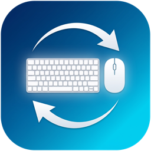
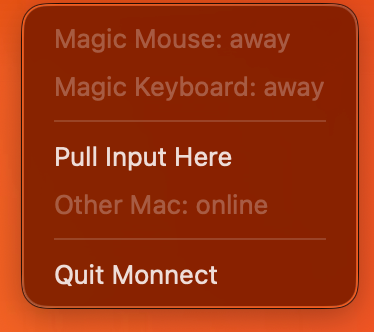
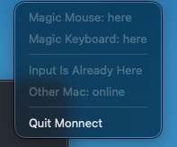

<p align="center">
  
</p>

<h1 align="center">monnect</h1>

Switch a Magic Mouse and Magic Keyboard between two Macs with one click —
no cable, no KVM, no Universal Control.

<p align="center">
  
  &nbsp;&nbsp;
  
</p>

Apple's Magic peripherals can only be paired with **one** host at a time.
If you use the same mouse and keyboard with two Macs (say, a personal and a
work MacBook), the usual "fix" is plugging in a cable every time you switch.
monnect replaces that ritual with a menu bar app: click **Pull Input Here**
on the Mac you want to use, and the devices jump over in a few seconds.

```
Mac you're sitting at                    Mac that has the devices
  "Pull Input Here" ── local network ──▶ unpairs them
  pairs + connects them ◀── devices are now free to switch
```

## Install

On **each** Mac:

```bash
brew install --cask eimen2018/tap/monnect
```

or download the notarized DMG from
[Releases](https://github.com/Eimen2018/monnect/releases) and drag
`Monnect.app` to Applications. Nothing else to install.

## Set up

1. Open Monnect on the Mac your mouse and keyboard work with now. Choose
   **Set Up My First Mac**, allow Bluetooth, and pick your devices.
2. It shows a pairing code like `K7QM2-XFD9P`. On the other Mac, open
   Monnect, choose **Join My Other Mac**, and type the code (case and
   dashes don't matter). If the second Mac can't find the first (some
   networks block discovery), type the address shown under the code too.
3. Allow the **local network** prompt on both Macs, and leave **Open
   Monnect when I log in** on.

The second Mac doesn't need the devices paired beforehand.

**Upgrading from 0.1.x:** install 0.2 on **both** Macs. They keep working
together without setting up again: each derives its new key from the old
shared token. That token used to cross the network in cleartext, so
Settings suggests pairing once more (Settings → Pair Another Mac on one
Mac, Join on the other) to replace it with a fresh key.

## Daily use

Click the keyboard icon in the menu bar → **Pull Input Here**. Devices you
were just using on the other Mac follow in about 4–5 seconds, no touching
needed. A device that has gone to sleep needs waking: the menu asks you to
tap a key or click. A filled icon means the devices are on this Mac. If one
still won't come, power-cycle it (off, 3 s, on).

You can trigger a switch from anything that can open a URL — Raycast,
Shortcuts, a hotkey tool:

```bash
open -g monnect://pull      # bring the devices here
open -g monnect://release   # let go of them
```

## How it works

Magic devices store exactly **one** pairing, and a paired device ignores
connection attempts from any other host. So "keep it paired to both and
reconnect" is impossible. What works:

1. The current owner **unpairs** the devices.
2. The new owner **pairs fresh** (Magic devices pair without a PIN),
   giving each device a few seconds to answer before moving to the next.
   An awake device pairs within a second or two; one that's asleep doesn't
   answer, and the next device gets its turn instead of waiting out a 15 s
   page timeout. Measured on two MacBooks (macOS 26 and 27), a switch takes
   about **4–5 seconds**, without touching the devices.
3. A device only answers while **awake** — that's the firmware, not
   something software can change. A device in use on the other Mac *is*
   awake when it's released, so it comes over on its own; one that has
   dozed off needs a key tap or a click. The claim retries fast for 90 seconds,
   then keeps watching with growing pauses, so a device that slept through
   the switch joins whenever it wakes. The other Mac taking it, or this Mac
   going to sleep, stops the watch.

The Macs find each other over Bonjour and talk over TLS with a pre-shared
key (TLS-PSK) that pairing gives both of them. Every message carries each
Mac's state (awake, which devices it holds, which it's claiming), so either
side always knows where the devices are. Bluetooth goes through IOBluetooth
directly: connection changes show up instantly, and nothing polls.

### Lid close

A MacBook that's asleep with the lid closed still answers its devices'
reconnect attempts, which turns the other Mac's claim into a coin toss.
So when the lid closing puts a Mac to sleep, Monnect asks the other Mac
whether it's awake. If it is, this Mac lets go of the devices before
sleeping (sleep waits briefly while it does). If the other Mac is asleep
or away, it keeps them, and reopening the lid reconnects natively.

It doesn't let go in clamshell mode with an external display, where the
keyboard has to stay able to wake the Mac.

While the lid is shut, nothing is ever *claimed*, not even during Power
Nap wakes. If the other Mac was asleep at lid close but has since been
woken and is in use, the closed Mac lets go when its next Power Nap wake
ends, so pulling there goes smoothly.

On wake, it reclaims whatever the other Mac neither holds nor is busy
claiming. Turn the whole behavior off in Settings.

## Limitations, honestly

- **Sleeping devices need a nudge.** Devices in use come over by
  themselves; one that has gone to sleep needs a key tap or a click
  (the menu says when). A power-cycle always works.
- Mid-switch, the devices are paired to **neither** Mac. Pulling again is
  always safe; worst case, one cable plug-in restores things.
- Both Macs need to be on the same local network for the handoff. If the
  other Mac can't be reached, the claim still runs.
- Two Macs per pairing.

## Security

- The Macs talk over TLS 1.2 with a pre-shared key: a random 256-bit
  secret stored in `~/Library/Application Support/Monnect/config.json`
  (readable only by you). Without it, nobody on your network can read the
  traffic or make your Mac release its devices.
- Pairing encrypts that secret under an X25519 key agreement mixed with the
  pairing code (HKDF + AES-GCM). It isn't a PAKE, so the code is long:
  50 bits, more than an offline search can cover in the five minutes a
  code lives. The showing Mac allows five wrong guesses per code, then
  stops.
- The only connection beyond your LAN is a daily anonymous version check
  against GitHub Releases (turn it off in Settings).

## Troubleshooting

| Symptom | Fix |
|---|---|
| "Other Mac: not found" | Is Monnect running on both? Did you allow **local network** access on both (System Settings → Privacy & Security → Local Network)? Same network? |
| A device never joins | It's asleep or out of range. Power-cycle it; the app is still watching for it. |
| Devices drift back to the other Mac | Monnect isn't running there, so nothing let go. Open it and pull again. |
| Anything else | Settings → **Show Log in Finder** and look at `Monnect.log`. |

## Building from source

```bash
git clone https://github.com/Eimen2018/monnect && cd monnect/app
swift test               # unit + two-instance integration tests
./make-app.sh            # dist/Monnect.app (ad-hoc signed)
```

`MONNECT_CONFIG_DIR=<dir>` runs an instance with its own config and log;
add `MONNECT_FAKE_BT=<file>` to use simulated devices shared through that
file. Two such instances on one Mac can switch fake devices between them
for real, over the network code.

## License

[MIT](LICENSE)
